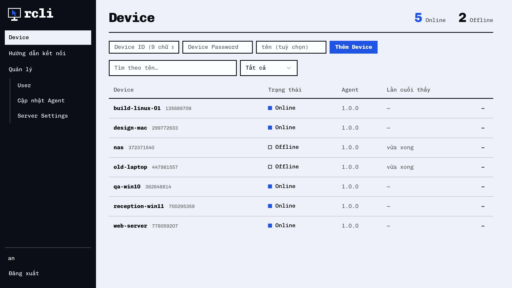

<p align="center">
  
  
</p>

<p align="center"><b>Remote control for AI agents and scripts.</b><br>
<a href="https://rcli.eigentlab.com">Website</a> · <a href="https://rcli.eigentlab.com/en/usage/">Docs</a> · <a href="https://github.com/EigentLab/remote-cli/releases">Download</a> · <a href="README.vi.md">Tiếng Việt</a></p>

rcli lets Claude Code, other AI agents and your scripts see the screen, click, type and run commands on Windows, macOS and Linux Devices, through a Server you host. Every Action is one `rcli` command (add `--json` for scripts) or one MCP tool, and each screenshot comes back with its controls numbered, so an agent clicks "Mark 5" or the text "Install now" instead of guessing pixels. People get a Dashboard with Live View and a web terminal on the same Server.



## Features

- **Screens for agents**: screenshots with numbered Marks from the accessibility tree (OCR where there is none), and Wait Conditions that wait for text to appear instead of sleeping.
- **Input**: click, type, keys, scroll and set a field's value, by Mark, text or coordinates; several Actions in one request.
- **Terminal**: `rcli exec` with the command's exit code, `rcli shell` for an interactive shell, as root when the Device allows it.
- **Lock and login screens, UAC**: in Service Mode. rcli stores no OS password; the Controller types it.
- **Power and Wake**: lock, sleep, restart, shut down, and Wake-on-LAN through another Device on the same LAN.
- **One Controller at a time**: the Control Lock, so two agents do not fight over one mouse.
- **The Device decides**: its own Device Settings say what Controllers may do; adding a Device takes its Device ID and Device Password.
- **Self-hosted**: one command installs the Server, with HTTPS on a bare IP address from the Server's own CA. AGPL-3.0.

## How it works

```text
 AI agent, script, person               your Server                 your Devices
 rcli · rcli mcp · Dashboard  ──HTTPS──▶  Controller API  ◀──TLS:9443──  rcli Agent
```

One `rcli` binary runs on every machine. Installed, it makes the machine a **Device** (its Agent keeps a connection to the Server, so others can drive it) and a **Controller** (it can drive others). The Server only connects them: it holds Users and their Address Books, and relays each Action to the Agent, which acts and sends back the Observation. The words are defined in [GLOSSARY.md](GLOSSARY.md).

## Install

Download from the [latest release](https://github.com/EigentLab/remote-cli/releases/latest) (check the files with `SHA256SUMS`). The builds are not code-signed.

| OS | File | Install |
|---|---|---|
| Windows x86_64 | `rcli-<version>-windows-x86_64.exe` | Save it as `rcli.exe` and open it (SmartScreen: More info, Run anyway) |
| macOS, Apple silicon | `rcli-<version>-macos-aarch64.dmg` | Drag `rcli` to Applications and open it; allow Screen Recording and Accessibility |
| Debian, Ubuntu x86_64 | `rcli_<version>_amd64.deb` | Write `/etc/rcli/agent.conf` ([how](https://rcli.eigentlab.com/en/devices/#the-deb-package)), then `sudo apt install ./rcli_<version>_amd64.deb` |
| Linux x86_64 | `rcli-<version>-linux-x86_64` | `chmod +x` it and run `./rcli-<version>-linux-x86_64 install` |

[Install on a Device](https://rcli.eigentlab.com/en/devices/) covers each OS, User Mode and Service Mode, and updating.

## Quick start: one machine, no Server

Drive the machine you are on as the **Local Device**. `rcli install` without `sudo` and without `--server` installs in User Mode for you alone (no root) and serves only local control.

```bash
rcli install                        # on macOS from the .dmg: /Applications/rcli.app/Contents/MacOS/rcli install
rcli shot local --marks             # saves a screenshot with numbered Marks and prints the Mark table
rcli act local click --text "OK"    # clicks the Mark labelled OK and saves the screenshot after it
```

On macOS, User Mode puts the app in `~/Applications` and links `rcli` at `~/.local/bin/rcli` (add it to your `PATH`); open that app once and allow it Screen Recording and Accessibility before the first `shot`. The screen must be unlocked: User Mode cannot see the lock screen. `rcli uninstall` removes it all again.

## Quick start: a Server and a Device

On a Linux x86_64 server (Debian or Ubuntu), one command installs Docker if needed, the Server and its Dashboard, and creates the first User:

```bash
curl -fsSL https://rcli.eigentlab.com/install.sh | sudo sh
# the same script: https://raw.githubusercontent.com/EigentLab/remote-cli/main/install.sh
```

It prints the Dashboard URL, the name `admin` with a password shown once, and the ports to open. With no argument it serves HTTPS on the server's IP address, port 3443, leaving ports 80 and 443 alone; `--domain`, `--tunnel` and `--behind-proxy` are the other modes ([Server guide](https://rcli.eigentlab.com/en/server/)). Then:

1. Sign in, and upload the `rcli` files from the release on **Cập nhật Agent** (Agent updates): new Devices download their `rcli` from there.
2. On the machine to drive, run the command from **Hướng dẫn kết nối** (Connect Guide). It installs rcli in Service Mode and prints the Device's ID and password.
3. On your own machine, install rcli with the same Server, add the Device, and drive it:

```bash
sudo rcli install --server 203.0.113.10:9443 --key rk_xxxxxxxx_yyyyyyyy   # the Server Address and Server Key from the Connect Guide
rcli connect 123456789 --name demo-pc                                      # asks for the Device Password once
rcli shot demo-pc --marks
rcli lock acquire demo-pc && rcli act demo-pc click --text "OK"
rcli exec demo-pc -- uname -a
```

## MCP with Claude Code

On a machine where rcli is installed:

```bash
claude mcp add rcli -- rcli mcp
```

`rcli mcp` uses the install's configuration and the Device Passwords you remembered with `rcli connect`, so it needs no other setup. Its tools are `devices`, `device`, `lock_acquire`, `lock_release`, `lock_status`, `observe`, `act`, `batch`, `exec`, `wake` and `power`; screenshots come back inline with the Mark table. `device: "local"` drives the Local Device. Then ask Claude Code, for example, *"Install the waiting updates on demo-pc."*

## Skill for AI agents

`skills/rcli/` teaches an agent the `rcli` CLI: the rules (Control Lock, secrets, what to ask first), recipes and a command reference. For Claude Code:

```bash
cp -R skills/rcli ~/.claude/skills/
```

## Build from source

```bash
git clone https://github.com/EigentLab/remote-cli && cd remote-cli
cargo build --release -p rcli --features gui    # target/release/rcli, with the rcli window
docker compose build                            # the Server and Dashboard images
```

GPU encoding for Live View and the release packages need more: see [Build from source](https://rcli.eigentlab.com/en/build/).

## Links

- [Docs](https://rcli.eigentlab.com/en/usage/): [using rcli](https://rcli.eigentlab.com/en/usage/), [Server guide](https://rcli.eigentlab.com/en/server/), [Install on a Device](https://rcli.eigentlab.com/en/devices/), [Known limitations](https://rcli.eigentlab.com/en/limitations/)
- [GLOSSARY.md](GLOSSARY.md) and the design decisions in [docs/adr](docs/adr)
- [CONTRIBUTING.md](CONTRIBUTING.md): issues are welcome here; pull requests are applied in the dev repo
- [SECURITY.md](SECURITY.md): report a vulnerability privately
- Licence: [AGPL-3.0](LICENSE). The Dashboard's text is in Vietnamese.
