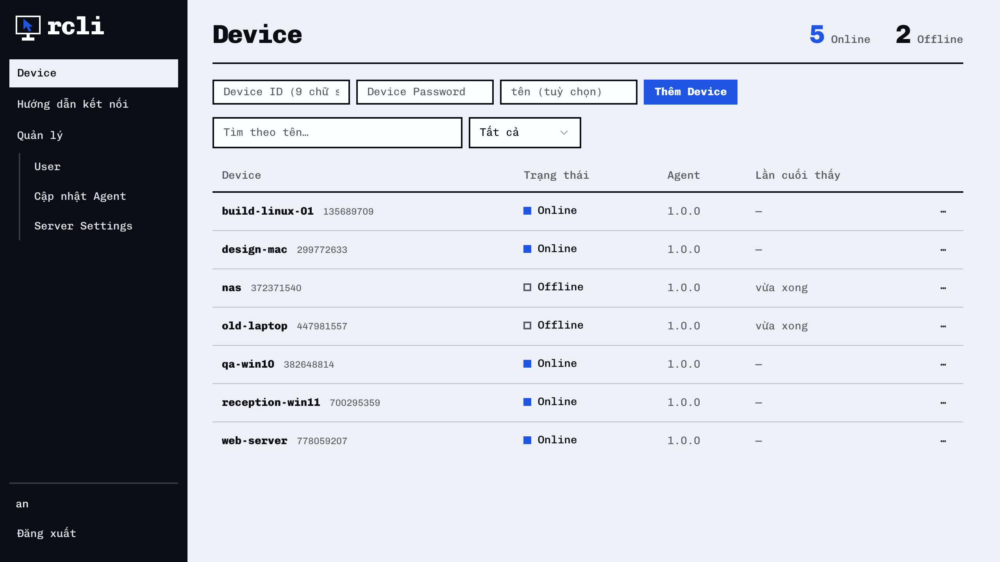

<p align="center">
  <picture>
    <source media="(prefers-color-scheme: dark)" srcset="assets/icons/readme-header-dark.png">
    
  </picture>
</p>

<p align="center"><b>Điều khiển máy từ xa cho AI agent và script.</b><br>
<a href="https://rcli.eigentlab.com/vi/">Website</a> · <a href="https://rcli.eigentlab.com/vi/usage/">Tài liệu</a> · <a href="https://github.com/EigentLab/remote-cli/releases">Tải về</a> · <a href="README.md">English</a></p>

rcli cho Claude Code, các AI agent khác và script của bạn xem màn hình, click, gõ phím và chạy lệnh trên máy Windows, macOS và Linux, qua một Server do bạn tự host. Mỗi Action là một lệnh `rcli` (thêm `--json` cho script) hoặc một MCP tool, và mỗi ảnh màn hình trả về có đánh số các control, nên agent click "Mark 5" hay chữ "Install now" thay vì đoán toạ độ. Người dùng có thêm Dashboard với Live View và web terminal trên cùng Server.



## Tính năng

- **Màn hình cho agent**: ảnh màn hình có đánh số Mark từ accessibility tree (OCR khi không có), và Wait Condition chờ một dòng chữ hiện ra thay vì `sleep`.
- **Nhập liệu**: click, gõ phím, tổ hợp phím, cuộn và đặt giá trị cho ô nhập, theo Mark, theo chữ hoặc theo toạ độ; nhiều Action trong một request.
- **Terminal**: `rcli exec` trả về exit code của lệnh, `rcli shell` cho shell tương tác, chạy bằng root khi Device cho phép.
- **Màn khoá, màn đăng nhập, UAC**: ở Service Mode. rcli không lưu mật khẩu OS; Controller tự gõ.
- **Nguồn và Wake**: khoá màn hình, sleep, khởi động lại, tắt máy, và Wake-on-LAN qua một Device khác cùng mạng LAN.
- **Mỗi lúc một Controller**: Control Lock, để hai agent không giành nhau một con chuột.
- **Device quyết định**: Device Settings của chính Device quy định Controller được làm gì; muốn thêm Device phải có Device ID và Device Password của nó.
- **Tự host**: một lệnh cài Server, HTTPS trên địa chỉ IP trần bằng CA riêng của Server. Giấy phép AGPL-3.0.

## Cách hoạt động

```text
 AI agent, script, người                Server của bạn              máy của bạn
 rcli · rcli mcp · Dashboard  ──HTTPS──▶  Controller API  ◀──TLS:9443──  rcli Agent
```

Mọi máy chạy cùng một binary `rcli`. Cài xong, máy đó vừa là **Device** (Agent của nó giữ kết nối tới Server để người khác điều khiển được) vừa là **Controller** (nó điều khiển được máy khác). Server chỉ nối hai bên: nó giữ các User và Address Book của họ, chuyển từng Action tới Agent, Agent thực hiện rồi gửi lại Observation. Các từ ngữ được định nghĩa trong [GLOSSARY.md](GLOSSARY.md).

## Cài đặt

Tải từ [bản phát hành mới nhất](https://github.com/EigentLab/remote-cli/releases/latest) (kiểm tra file bằng `SHA256SUMS`). Các bản build không được ký số.

| OS | File | Cài |
|---|---|---|
| Windows x86_64 | `rcli-<version>-windows-x86_64.exe` | Lưu thành `rcli.exe` rồi mở (SmartScreen: More info, Run anyway) |
| macOS, Apple silicon | `rcli-<version>-macos-aarch64.dmg` | Kéo `rcli` vào Applications rồi mở; cấp quyền Screen Recording và Accessibility |
| Debian, Ubuntu x86_64 | `rcli_<version>_amd64.deb` | Ghi `/etc/rcli/agent.conf` ([cách ghi](https://rcli.eigentlab.com/vi/devices/#package-deb)), rồi `sudo apt install ./rcli_<version>_amd64.deb` |
| Linux x86_64 | `rcli-<version>-linux-x86_64` | `chmod +x` rồi chạy `./rcli-<version>-linux-x86_64 install` |

[Cài trên Device](https://rcli.eigentlab.com/vi/devices/) nói chi tiết từng OS, User Mode và Service Mode, và cách cập nhật.

## Bắt đầu nhanh: một máy, không cần Server

Điều khiển chính máy bạn đang dùng như **Local Device**. `rcli install` không có `sudo` và không có `--server` sẽ cài ở User Mode cho riêng bạn (không cần root) và chỉ điều khiển cục bộ.

```bash
rcli install                        # trên macOS từ file .dmg: /Applications/rcli.app/Contents/MacOS/rcli install
rcli shot local --marks             # lưu ảnh màn hình có đánh số Mark và in bảng Mark
rcli act local click --text "OK"    # click vào Mark có nhãn OK và lưu ảnh màn hình sau đó
```

Trên macOS, User Mode đặt app vào `~/Applications` và tạo link `rcli` ở `~/.local/bin/rcli` (thêm thư mục này vào `PATH`); mở app đó một lần và cấp quyền Screen Recording và Accessibility trước lệnh `shot` đầu tiên. Màn hình phải đang mở khoá: User Mode không thấy màn khoá. `rcli uninstall` gỡ sạch.

## Bắt đầu nhanh: một Server và một Device

Trên một server Linux x86_64 (Debian hoặc Ubuntu), một lệnh cài Docker nếu chưa có, cài Server cùng Dashboard và tạo User đầu tiên:

```bash
curl -fsSL https://rcli.eigentlab.com/install.sh | sudo sh
# cùng script đó: https://raw.githubusercontent.com/EigentLab/remote-cli/main/install.sh
```

Lệnh in ra URL của Dashboard, tên `admin` kèm mật khẩu chỉ hiện một lần, và các cổng cần mở. Không có tham số thì nó phục vụ HTTPS trên địa chỉ IP của server, cổng 3443, không đụng tới cổng 80 và 443; `--domain`, `--tunnel` và `--behind-proxy` là các chế độ khác ([Hướng dẫn Server](https://rcli.eigentlab.com/vi/server/)). Sau đó:

1. Đăng nhập, rồi tải các file `rcli` của bản phát hành lên trang **Cập nhật Agent**: Device mới tải `rcli` từ đó.
2. Trên máy cần điều khiển, chạy lệnh trên trang **Hướng dẫn kết nối**. Lệnh cài rcli ở Service Mode và in Device ID cùng Device Password.
3. Trên máy của bạn, cài rcli với cùng Server, thêm Device rồi điều khiển:

```bash
sudo rcli install --server 203.0.113.10:9443 --key rk_xxxxxxxx_yyyyyyyy   # Server Address và Server Key lấy từ Hướng dẫn kết nối
rcli connect 123456789 --name demo-pc                                      # hỏi Device Password một lần
rcli shot demo-pc --marks
rcli lock acquire demo-pc && rcli act demo-pc click --text "OK"
rcli exec demo-pc -- uname -a
```

## MCP với Claude Code

Trên một máy đã cài rcli:

```bash
claude mcp add rcli -- rcli mcp
```

`rcli mcp` dùng cấu hình của bản cài và các Device Password bạn đã lưu khi `rcli connect`, nên không cần thiết lập gì thêm. Các tool gồm `devices`, `device`, `lock_acquire`, `lock_release`, `lock_status`, `observe`, `act`, `batch`, `exec`, `wake` và `power`; ảnh màn hình trả về trực tiếp kèm bảng Mark. `device: "local"` điều khiển Local Device. Rồi nhờ Claude Code, chẳng hạn: *"Cài các bản cập nhật đang chờ trên demo-pc."*

## Build từ mã nguồn

```bash
git clone https://github.com/EigentLab/remote-cli && cd remote-cli
cargo build --release -p rcli --features gui    # target/release/rcli, có cửa sổ rcli
docker compose build                            # image của Server và Dashboard
```

Mã hoá Live View bằng GPU và các gói phát hành cần thêm bước: xem [Build từ mã nguồn](https://rcli.eigentlab.com/vi/build/).

## Liên kết

- [Tài liệu](https://rcli.eigentlab.com/vi/usage/): [hướng dẫn sử dụng](https://rcli.eigentlab.com/vi/usage/), [Hướng dẫn Server](https://rcli.eigentlab.com/vi/server/), [Cài trên Device](https://rcli.eigentlab.com/vi/devices/), [Giới hạn đã biết](https://rcli.eigentlab.com/vi/limitations/)
- [GLOSSARY.md](GLOSSARY.md) và các quyết định thiết kế trong [docs/adr](docs/adr)
- [CONTRIBUTING.md](CONTRIBUTING.md) (tiếng Anh): issue được đón nhận ở repo này; pull request được áp dụng ở repo phát triển
- [SECURITY.md](SECURITY.md) (tiếng Anh): báo lỗ hổng một cách riêng tư
- Giấy phép: [AGPL-3.0](LICENSE). Giao diện Dashboard bằng tiếng Việt.
